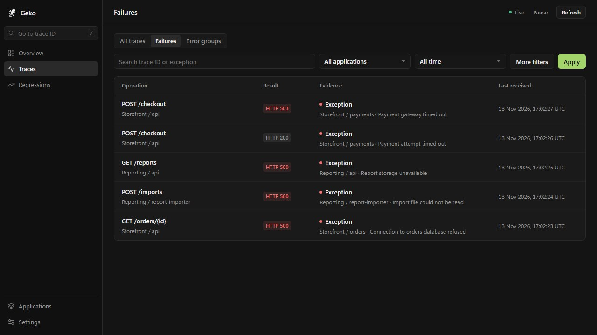
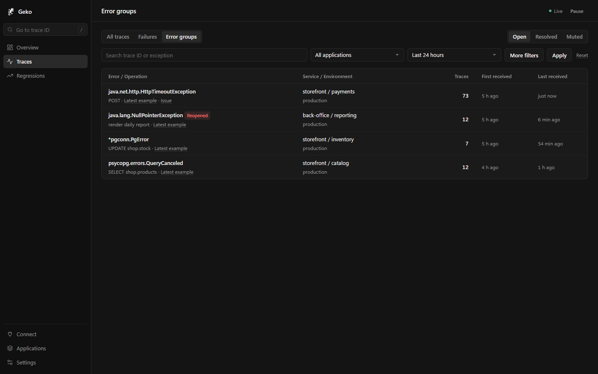
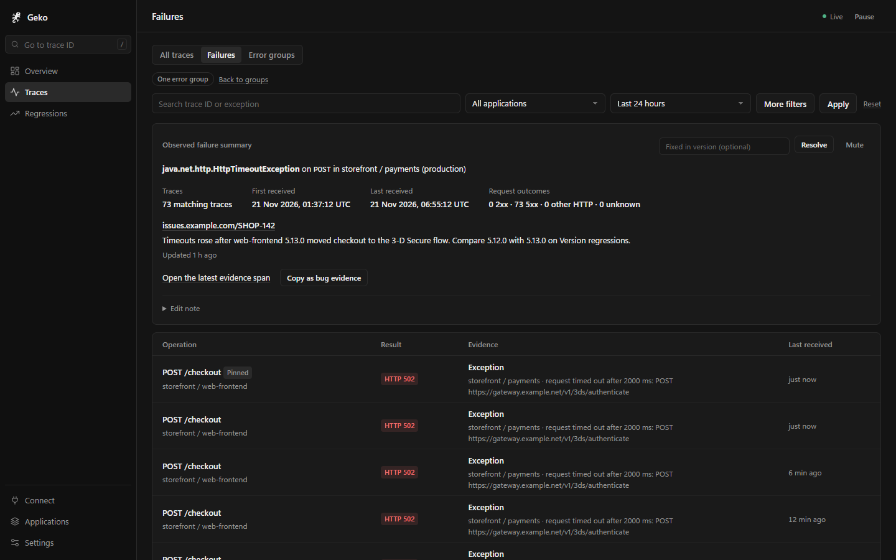
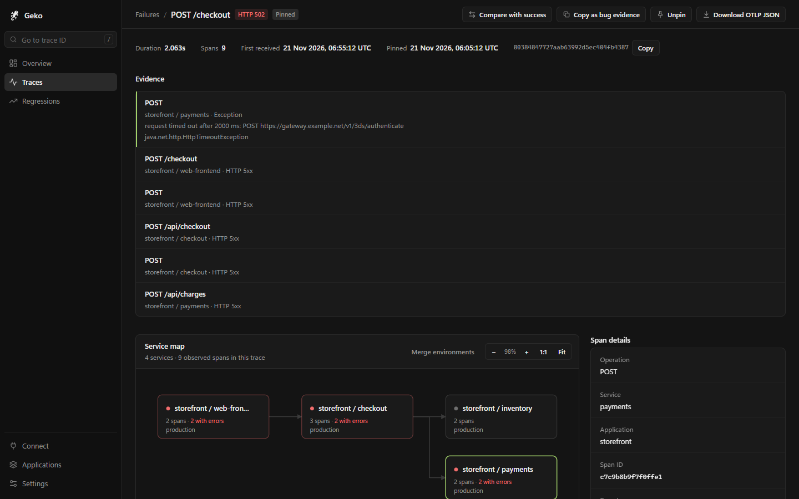
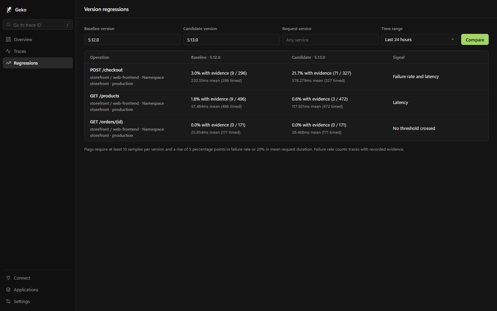

<div align="center">
  
  <h1>Geko</h1>
  <p><strong>Find the failure. Follow the trace.</strong></p>
  <p>A local, failure-first dashboard for OpenTelemetry traces. One Go binary, SQLite storage, no Docker or external services required.</p>
  <p>
    <a href="https://github.com/YunusEmreAlps/geko/actions/workflows/ci.yml"></a>
    <a href="https://github.com/YunusEmreAlps/geko/releases"></a>
    <a href="go.mod"></a>
    <a href="LICENSE"></a>
  </p>
  <p>
    <a href="#quick-start">Quick start</a> ·
    <a href="#connect-your-application">Connect your app</a> ·
    <a href="docs/investigate.md">Investigate</a> ·
    <a href="docs/server.md">Run for a team</a> ·
    <a href="docs/configuration.md">Configuration</a> ·
    <a href="#how-geko-compares">Compare</a>
  </p>
</div>



*Screenshots use synthetic traces from a single-service reporting API and an
online store with separate order, inventory, and payment services.*

## Why Geko

- **Starts with what broke.** The first screen lists requests whose spans
  recorded an exception, an HTTP 5xx, or an error status, not every trace you sent.
- **Keeps outcome and evidence apart.** A checkout that returns HTTP 200 after a
  retried payment timeout still shows the payment exception next to the
  successful response.
- **Hands the failure to your coding agent.** `geko mcp setup` registers Geko
  with Claude Code, Cursor or VS Code, and one `investigate_group` call gives
  the agent the stack trace, a successful request to compare with, and the
  release the failure started in. A [GitHub Action](docs/agents.md#report-failures-on-pull-requests)
  comments the failing traces of a test run on the pull request.
- **Runs entirely on your machine.** A single process receives OTLP/HTTP and optional OTLP/gRPC,
  stores spans in SQLite with retention and a size limit, and serves the
  dashboard on a loopback address by default.
- **Is careful with data.** An attribute allowlist drops headers, cookies,
  bodies, and full URLs before anything is stored, and e-mail addresses, card
  numbers, IBANs and Turkish identity numbers are masked. A `strict` mode, the
  default on a token-protected server, keeps only exception types and message
  hashes.
- **Diagnoses the Collector.** Collector Doctor checks pipeline wiring and
  reports refused telemetry, export failures, and queue pressure.
- **Shows where trace volume comes from.** Telemetry Budget reports hourly
  span volume, service limit overages, and high-cardinality attributes.

## Quick start

See Geko on a synthetic dataset before you instrument anything. `geko demo`
seeds six hours of traces from seven services into a temporary database,
serves it, and opens the dashboard; stopping it deletes the data.

```sh
git clone https://github.com/YunusEmreAlps/geko.git
cd geko
go run ./cmd/geko demo
```

Open **Traces → Error groups**, select `java.net.http.HttpTimeoutException`,
and open a trace: the evidence span is the payment gateway call that timed
out. Then open **Regressions** and compare `5.12.0` with `5.13.0`, the
web-frontend release that made those timeouts frequent.

<details>
<summary>The demo, step by step</summary>






</details>

To try it with your own traces, start Geko and send one:

```sh
go run ./cmd/geko serve --open
```

In a second terminal, send a synthetic multi-service trace from the
repository root:

```sh
# bash / zsh
OTEL_EXPORTER_OTLP_TRACES_ENDPOINT=http://127.0.0.1:4318/v1/traces go run ./examples/service-map
```

```powershell
# PowerShell
$env:OTEL_EXPORTER_OTLP_TRACES_ENDPOINT = 'http://127.0.0.1:4318/v1/traces'
go run ./examples/service-map
```

Refresh **Failures** and open **POST /checkout**. More examples:

| Example | What it sends |
| --- | --- |
| [Go checkout](examples/go/README.md) | Real HTTP requests through the OpenTelemetry SDK, with success, failure, and retry routes. |
| [Node, Python, Java and .NET SDKs](examples/sdk/README.md) | Real SDK exporters, successful/failing loopback requests, resource metadata, run IDs and explicit shutdown. |
| [OTLP/HTTP JSON](examples/otlp-json/README.md) | A synthetic HTTP 503 trace from Node.js, Python, Java, or .NET, using only the standard library. |
| [Service map](examples/service-map/README.md) | One synthetic trace across five services, for exploring the map and waterfall. |

## Install

| Method | Command |
| --- | --- |
| Install script, Linux and macOS | `curl -fsSL https://raw.githubusercontent.com/YunusEmreAlps/geko/master/scripts/install.sh \| sh` installs to `~/.local/bin`. |
| Install script, Windows | `irm https://raw.githubusercontent.com/YunusEmreAlps/geko/master/scripts/install.ps1 \| iex` installs to `%LOCALAPPDATA%\Programs\Geko` and adds it to your PATH. |
| Scoop | `scoop bucket add geko https://github.com/YunusEmreAlps/geko`, then `scoop install geko/geko`. |
| Homebrew | `brew tap yunusemrealps/geko https://github.com/YunusEmreAlps/geko`, then `brew install yunusemrealps/geko/geko`. |
| Release archive | Download `geko_<version>_<os>_<arch>.tar.gz` (`.zip` on Windows) from [GitHub Releases](https://github.com/YunusEmreAlps/geko/releases), check it against `checksums.txt`, extract it, and run `./geko serve`. |
| Go | `go install github.com/YunusEmreAlps/geko/cmd/geko@latest`, then `geko serve`. Replace `latest` with a tag to pin a version. |
| Docker | `docker run --rm --network host -v geko-data:/data ghcr.io/yunusemrealps/geko`, or build it with `docker build -t geko .` |

The install scripts verify the archive against the release's `checksums.txt`
and take `GEKO_VERSION` to pin a release. `geko demo` and `serve --open` are
in releases from v0.2.0.

To run Geko for a team, in Docker with a token or on a server behind TLS, see
[Run Geko for a team](docs/server.md).

## Connect your application

Point your OpenTelemetry trace exporter at Geko. Your application keeps its
own port; Geko listens on 4318.

```sh
# bash / zsh
export OTEL_SERVICE_NAME=orders-api
export OTEL_EXPORTER_OTLP_TRACES_PROTOCOL=http/protobuf
export OTEL_EXPORTER_OTLP_TRACES_ENDPOINT=http://127.0.0.1:4318/v1/traces
```

```powershell
# PowerShell
$env:OTEL_SERVICE_NAME = 'orders-api'
$env:OTEL_EXPORTER_OTLP_TRACES_PROTOCOL = 'http/protobuf'
$env:OTEL_EXPORTER_OTLP_TRACES_ENDPOINT = 'http://127.0.0.1:4318/v1/traces'
```

Send a request to your application, then open **Settings → Receiver**. It shows
the effective trace endpoint, the last accepted export, and rejection counts by
reason.

OTLP/gRPC, a separate dashboard port and receiver limits are in
[Connect your application](docs/connect.md).

## Documentation

| Guide | Covers |
| --- | --- |
| [Investigate a failure](docs/investigate.md) | Failures, the service map and waterfall, applications, comparing with a success, version regressions, error groups and triage, notifications, moving a trace |
| [Run Geko for a team](docs/server.md) | Docker with a token, Compose with Caddy, access, ingest, read and triage tokens, roles, sign-in through a proxy, the audit log, token reload |
| [Coding agents and test runs](docs/agents.md) | `geko failures --json`, MCP over stdio and HTTP, `geko run` |
| [Connect your application](docs/connect.md) | Ports, OTLP/gRPC, receiver limits |
| [Configuration and reference](docs/configuration.md) | Every setting, retention and capacity, privacy modes, upgrades, CLI, JSON API |
| [Collector Doctor](docs/collector-doctor.md) | Diagnose Collector pipelines, export failures and queue pressure |
| [Telemetry Budget](docs/telemetry-budget.md) | Measure hourly span volume, service limits and attribute cardinality |
| [Architecture](docs/architecture.md) | Ingestion, storage, privacy filtering, evidence selection |

## How Geko compares

| Tool | Best for | Deployment |
| --- | --- | --- |
| **Geko** | Starting from failure evidence on a developer machine or a shared dev/staging instance: filter failures, open the evidence span, follow the trace's calls. | Single binary, loopback by default, SQLite with retention and a size limit. Traces only. |
| [Jaeger](https://www.jaegertracing.io/docs/2.23/features/) | Searching and inspecting traces and service dependencies at any scale. | All-in-one or separate collector and query roles with external storage. |
| [Zipkin](https://zipkin.io/) | Looking up traces by ID, service, operation, tags, and duration, with an aggregate dependency diagram. | In-memory or persistent backends such as Cassandra and Elasticsearch. |
| [OpenTelemetry Desktop Viewer](https://github.com/CtrlSpice/otel-desktop-viewer) | A local telemetry UI with SQL access. | Local CLI with a browser UI. |
| [otel-tui](https://github.com/ymtdzzz/otel-tui) | Browsing telemetry in a terminal UI. | Local terminal tool. |
| [Aspire Dashboard](https://aspire.dev/dashboard/standalone/) | Logs, traces, and metrics in one local dashboard. | Standalone container. |

## Development

```sh
go test ./...
go vet ./...
go test ./internal/ingest/otlp -run '^$' -fuzz '^FuzzReceiver$' -fuzztime 30s
go test ./internal/storage/sqlite -run '^$' -bench .
```

To measure one process end to end, without Docker or another backend:

```sh
go build -o bin/geko ./cmd/geko
python scripts/bench-native.py --binary bin/geko --rounds 4
python scripts/bench-ingest-concurrency.py --binary bin/geko
```

The latest figures are in
[competitive research](docs/competitive-research.md#single-process-measurement).

To re-record the demo walkthrough and its screenshots, with Playwright
installed (`PLAYWRIGHT_CHANNEL=msedge` or `chrome` uses an installed browser):

```sh
node scripts/record-walkthrough.mjs bin/geko docs/media
```

CI also runs staticcheck, govulncheck, race tests, `go mod tidy -diff`, and a
Docker smoke test with the JSON exporters. CI also builds a release snapshot,
verifies the archive checksums, and runs the Linux amd64 binary. Run
`goreleaser release --snapshot --clean` locally to generate the same archives
in `dist/`. Pushing a `v*` tag publishes checksummed archives for Linux, macOS,
and Windows on amd64 and arm64, and a `linux/amd64` and `linux/arm64` image to
`ghcr.io/yunusemrealps/geko`. See [Releasing](docs/releasing.md).

## License

[MIT](LICENSE)
