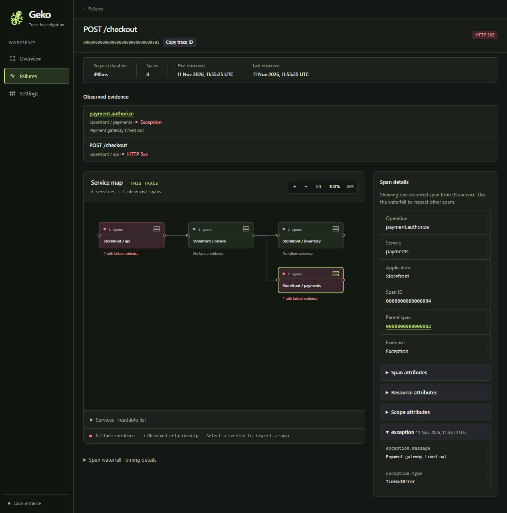
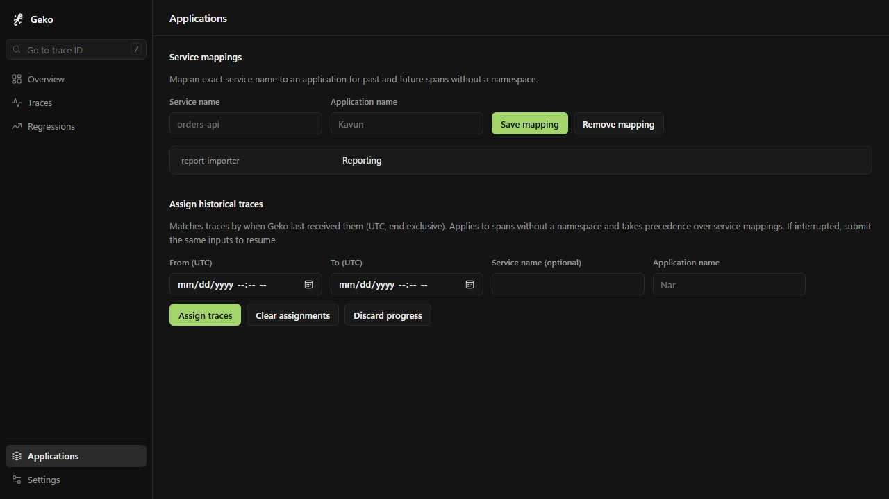

# Investigate a failure

Find a failure, follow its trace, and triage recurring errors. [Back to the README](../README.md).

1. **Find it.** Filter **Failures** by application, request (entry) service,
   evidence service, HTTP status, time range, or search text. **Overview**
   summarizes the last 24 hours. To open any stored trace, including a
   successful one, paste its ID into **Go to trace ID** in the sidebar (press `/`). Open **All traces** to
   browse successful and failing requests together with the same filters.
2. **Open the evidence.** Selecting an operation jumps to the evidence span.
   **Evidence** lists every span with an exception event, an HTTP 5xx,
   or an explicit error status.
3. **Follow the calls.** The **Service map** shows the parent–child calls
   observed in this trace, and the **Span waterfall** compares start times and
   durations. **Span details** shows the stored attributes, events, and stack
   traces.

## Save recurring project views

In source builds after v0.2.0, open **Saved views** below the filters in **All
traces**, **Failures** or **Error groups**. Apply your application/service/time
filters, enter a name and choose **Save current view**. Up to 12 views can be
saved; names have at most 64 characters. Reusing a name (ignoring case) replaces
it. **Remove** deletes one view; **Clear local data** removes this local workspace.

Views keep application, request/evidence service, time range, HTTP status, pins,
and error-group view/state. They omit text searches, protected attribute digests,
run IDs, individual group IDs, pagination and trace payloads. If one of those
omitted filters was active, reopening the view can show a broader result set.
Apply filters before saving: unsent form edits are not saved.

**Overview → Resume last view** returns to the most recent list context after
you have saved a view or enabled recent investigations. It opens only on click;
Geko never redirects you or silently applies project filters. Relative time
ranges are evaluated again, so Last hour remains the latest hour.

**Remember recent investigations** is optional and off by default. When enabled,
it keeps up to 20 unique trace IDs and visit times, with no operation names,
exceptions or span contents. Entries older than 30 days are removed on the next
workspace visit. Selecting another span in a trace updates its single entry.
Opening a missing trace does not add it; if a saved trace later expires or is
evicted, its link uses the existing missing-trace diagnostics. Disabling the
option clears the recent list. **Clear recent investigations** keeps the option
enabled but clears its entries.

Preferences live in this browser on this site, separated by signed-in identity
and role; they do not sync to the server or between browsers. They are browser
conveniences, not an authorization boundary: use separate browser profiles on a
shared computer. Signing out does not delete preferences; **Clear local data**
or the browser's site-data controls removes them. A server/database change at the
same URL can leave old project links behind. Existing access checks still apply
to every opened trace. If JavaScript or browser storage is unavailable, the
normal server-rendered filters and trace lookup keep working.

## Keep investigation context

**Back to results** retains the application, time range, filters, group and
page you opened the trace from. **Expand span details** gives long stack traces
the full workspace width; **Use split view** restores the waterfall/map beside
the inspector. Parent, span and pagination links keep the reader mode.

If a trace ID is not found, use the page's receiver, Connect and retention
checks. The missing ID alone cannot establish whether a trace never arrived,
was sampled out, belongs to another instance or was removed by storage policy.

In the store example, `POST /checkout` returns HTTP 503. The map shows calls to
inventory and payments; open `payment.authorize` to see the gateway timeout.



The map groups instances by application, namespace, service name, and
deployment environment. **Merge environments** combines environments of the
same service. It reads up to 500 spans and marks partial results; the evidence
list and waterfall page through the whole trace.

## Group multiple applications

Several applications can share one Geko, even when each one names its service
`api`. Set `service.namespace` per application, for example through
`OTEL_RESOURCE_ATTRIBUTES=service.namespace=Storefront`, and each namespace
becomes an **Application** filter.

For spans exported without a namespace, open **Applications** in the sidebar:

| Situation | What to do |
| --- | --- |
| A legacy `report-importer` service never sets a namespace | Map the exact service name to `Reporting`. The rule applies to past and future spans without a namespace. |
| Two apps both exported `api` without a namespace, and you know which one was active during a time window | Use **Assign historical traces** with that UTC range, narrowed to `api`. The range matches when Geko last received each trace. |



<details>
<summary>Precedence and edge cases</summary>

- An explicit `service.namespace` always wins. Without one, a historical trace
  assignment wins over a service mapping. Clearing the assignment restores the
  mapping, or **Ungrouped**.
- A trace that spans two applications appears under both filters. Its detail
  page always shows the full trace.
- If both apps sent traces under the same service name in the same window,
  leave that window unassigned unless you can narrow it further.
- Historical assignments commit in batches. To resume an interrupted update,
  submit the same range, service, and application. **Discard progress** keeps
  the batches that already completed.
- If a trace receives a new span before its batch runs, its last receipt time
  can move outside the range, and the trace is skipped.

</details>

If your team also sends traces to Grafana Tempo or Jaeger, set
`trace_link_url` and each trace page gets an **Open in Tempo** button for the
same trace ID. See [Configuration](configuration.md).

For a trace with failure evidence and a unique entry span, select **Compare
with success**. Geko picks the most recently received trace with an HTTP 2xx
entry span and no failure evidence for the same application, namespace,
service, operation and environment. The comparison shows both request
durations, the difference, span counts and a link to each trace.

In source builds after v0.2.0, the comparison page also offers **Successful
trace ID → Compare selected trace**. Open **All traces**, find a suitable
successful request, and paste its 32-character ID. The chosen trace can be older
than the automatic reference; service versions may differ. The same eligibility
rules still apply: a unique root server span with HTTP 2xx, no failure evidence
anywhere in the baseline, and matching entry operation/service/application/
namespace/environment. The source must have failure evidence and a unique entry.

The page labels a **Selected reference** explicitly. Ineligible and no-longer-
retained IDs leave the selection editable and explain the failed requirements;
Geko does not silently substitute another trace. **Use automatic match** removes
the explicit reference and returns to the latest matching retained success.
The results-return context is preserved. This is a native GET form and works
without JavaScript. The URL carries `baseline=<trace ID>`; it reads retained data
without pinning, copying or modifying either trace. Existing CLI/MCP automatic
comparison calls keep their current behavior.

Both summaries, eligibility and bounded span facts are read from one database
snapshot. A later export, retention or mapping change can alter a subsequent
comparison. A single successful example is not a statistical performance baseline
or proof that a code change fixed a failure; compare repeatable runs for that.

**Span operation differences** also compares call counts, evidence counts and
total observed span durations by application, namespace, service, environment,
operation and span kind. Repeated calls are grouped, not paired one-to-one;
inclusive durations may overlap and do not identify a cause. Both sides come
from one database snapshot. Work is bounded to the first 500 spans per trace
and the first 100 operation groups, with evidence groups first. Any omitted
spans or groups are disclosed; "not observed" is not proof of absence.

Open **Regressions** in the sidebar to compare two recorded `service.version`
values in a time range. Geko matches entry spans by application, namespace,
service, operation and environment. The table flags increases of at least
5 percentage points in failure evidence rate or 20% in mean request duration,
with at least 10 relevant samples in each version. These thresholds highlight
changes in the observed traces.

The version/service fields and dashboard **Compare runs** fields offer native
suggestions from recent retained telemetry. The sample is bounded to 1,000
traces, 10,000 spans and 100 values per list; it can omit older or unsampled
values. Type or paste any known version or run ID when it is not suggested.
Run labels describe a representative retained service context, not every
service in that run. No extra version/run index or history store is created.

When a selected span has a recorded exception stack trace, expand **Open
source in VS Code** to open a recognized file and line. Links use absolute
paths recorded by the service, so those paths need to resolve on the machine
running VS Code. Relative frames and unmatched formats remain visible as
stack trace text.

## Error groups and live updates

In **Failures**, choose **Error groups** to see recurring failures with trace
counts and first/last receipt times. Click a count for an observed failure
summary and matching traces, or **Latest example** to inspect the evidence
span immediately. The summary separates request HTTP outcomes from the
evidence span's status and links to the latest matching span. Application,
service, search and time filters apply to the summary and trace list.

Triage a group from its summary: **Resolve** hides it until a matching trace is
received again, when it returns to the open list marked **Reopened**. **Mute**
hides it for good and stops its notifications. **Open**, **Resolved** and **Muted**
next to the view switcher list each state. Groups first received since your
last visit to the open list are marked **New** in that browser. Triage states
expire with trace retention. Because the application is part of a group's
identity, changing a service mapping starts new groups.

Enter the release that contains the fix in **Fixed in version** when you resolve
a group. Geko then reopens it only for traces whose evidence service reports
that `service.version`, so failures from instances still running the old version
during a rollout don't reopen it. The group list shows **Resolved in 1.4.2**
while no matching trace from that version has arrived.

Use **Add a note or issue link** in the summary to record what the team knows
and link the Jira, Linear or GitHub issue. The group list shows an **Issue**
link, and `list_failure_groups` on `/mcp` returns them as `note` and `issue_url`. Notes
expire with trace retention, like triage states. Anyone who can triage can edit
them; the audit log records the change without the note's text.

**Pin trace** on a trace page keeps that trace past retention and capacity
eviction, for example as the reproduction attached to an issue. The trace
page and lists mark it **Pinned** with who pinned it, **More filters** →
**Pinned traces only** lists them, and **Settings** counts them. Anyone who
can triage can pin and unpin; the audit log records both.

**Copy as bug evidence**, in the summary and on each failing trace, copies a
Markdown description to paste into an issue: the failure, operation and
service, request outcome and duration, receipt times and links back to Geko.
A trace's copy includes its stored exception message; a group's never does.
Links use `public_url` when it is set.

Groups use each trace's primary evidence. Application, namespace, service,
environment, operation, error classification, exception type and span HTTP status
identify a group. Different instance IDs or messages do not split it; exceptions
without a type form broader groups. Counts cover retained traces, not every
exception event.

The first page updates automatically through SSE. **Pause**, next to the live indicator, keeps
the current results in place. Focused links and selected text are preserved;
use **Refresh results** when prompted. Older pages stay stable, and manual
refresh works without JavaScript. Changes made by another process directly to
the database require manual refresh. Only Geko's own pages can open the live
stream; browsers that send a cross-site `Sec-Fetch-Site` header are refused.

## Notifications

Set `GEKO_WEBHOOK_URL` to send a message when an error group is first received,
or when a resolved group recurs. Muted groups never notify. Geko checks every
30 seconds and sends at most five messages per check, then one summary.

`GEKO_WEBHOOK_FORMAT` is `slack`, `discord`, `ntfy` or `json`. Slack, Discord and
ntfy.sh URLs are recognized automatically; any other URL receives JSON with an
`event` (`new_group`, `reopened_group`, `summary`, `digest` or `test`), a `text` summary,
the group's fields and a dashboard `url`. Links use `public_url`, or the
dashboard address when it isn't set. Messages contain the exception type,
operation, service and counts, but never exception messages, which can contain
secrets. **Settings** shows the webhook's host and has **Send test
notification**, which sends to every configured webhook. This is not alerting: there are no thresholds or
escalation, and a failure in a trace that never reaches Geko sends nothing.

To send each team only its own groups, set `GEKO_APPLICATION_WEBHOOKS` to
comma-separated `application=url` pairs, for example
`Storefront=https://hooks.slack.com/services/…,Reporting=https://ntfy.sh/reporting`.
A group goes to its application's webhook instead of `GEKO_WEBHOOK_URL`, which
then receives only the groups of other applications; without it, those send
nothing. Each webhook gets at most five messages per check, and its summary
links to that application's groups. The format is inferred from each URL, so a
webhook that isn't Slack, Discord or ntfy.sh receives JSON. Application names
can't contain `,` or `=`.

### Owners

`owners` names the team that owns a group, so its notification says who
should look, before anyone has written a note:

```yaml
owners:
  services:
    payments: payments-team
  applications:
    Storefront: web-team
```

A rule for the evidence span's service wins over one for its application.
`GEKO_OWNERS=service:payments=payments-team,application:Storefront=web-team`
replaces the YAML rules. Notifications add an `Owner:` line and, in JSON, an
`owner` field; error groups, the group summary and the MCP group tools show it,
and **Settings** lists the rules.

### Weekly digest

`GEKO_DIGEST=monday 09:00` (or `digest: monday 09:00` in YAML), a weekday and a
whole hour in UTC, sends every configured webhook a summary of the past seven
days: how many of its groups received traces, the new, reopened and resolved
ones, and the largest. Each application webhook gets its own application's
groups, and `GEKO_WEBHOOK_URL` the rest. Muted groups are left out. JSON
webhooks receive `"event": "digest"` with the groups under `digest`. The digest
needs a webhook, and runs only while Geko is running at the scheduled hour.

## Storage by application

**Settings → Storage → By application** shows how the stored spans divide
between applications and the share of the size limit each one holds, and which
namespace or service `evict_fair` would evict from first. Counting reads every
stored trace, about 0.65 seconds per 100,000, so the page keeps its answer for a
minute.

## Move an error group between instances

**Download failure bundle** on an error group's summary saves one file with the
group, its note and issue link, and its ten newest traces as OTLP JSON. On
another Geko, **Import a failure bundle** at the bottom of **All traces**
restores the traces, opens the group they form there, and copies the note and
issue link when that group has none. The resolved or muted state stays behind,
since it belongs to the team that set it. Traces already stored are skipped,
so importing a bundle twice changes nothing. Importing needs the admin role,
like restoring a trace.

## Transfer a trace

Open a trace and select **Download OTLP JSON**. To load it into another Geko
instance, choose **Restore a trace** at the bottom of **All traces**. Each file
contains one trace and is limited to 4 MiB and 2,048 spans. A trace over the
limit cannot be downloaded through this feature.

Download and restore both apply the instance's current redaction policy.
The file carries span timing, IDs, relationships, and retained telemetry.
Geko assigns a new receipt time on restore. Application assignments and
retention settings belong to the destination database. A trace that is already
stored is not restored again (HTTP 409), so a file can never add spans to an
existing trace; open the stored trace instead.
