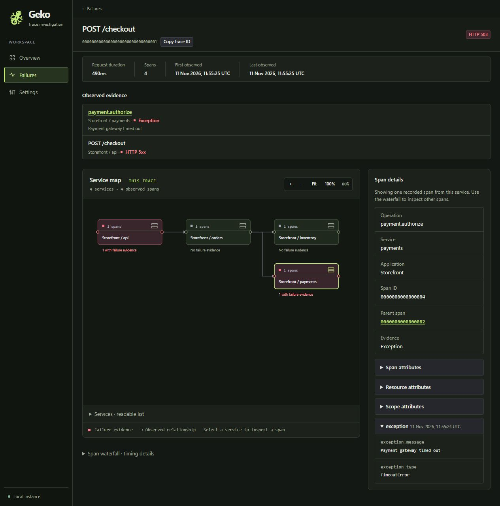
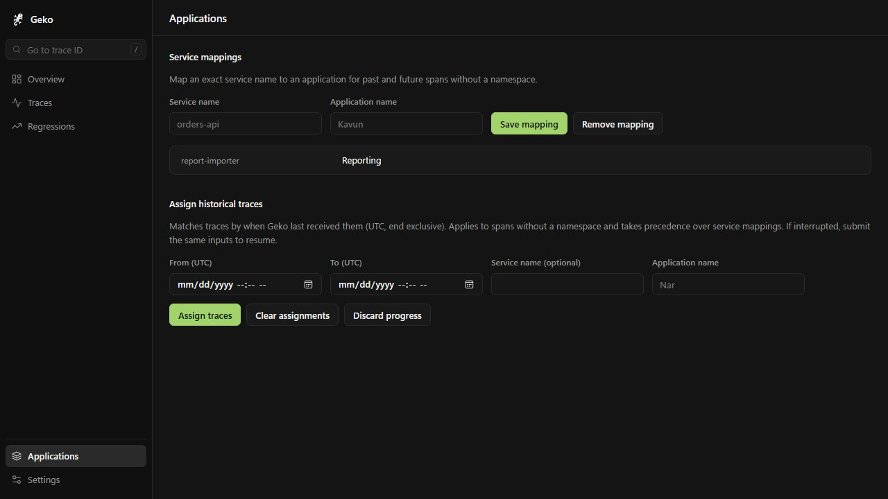

# Investigate a failure

Find a failure, follow its trace, and triage recurring errors. [Back to the README](../README.md).

1. **Find it.** Filter **Failures** by application, request (entry) service,
   evidence service, HTTP status, time range, or search text. **Overview**
   summarizes the last 24 hours. To open any stored trace, including a
   successful one, paste its ID into **Go to trace ID** in the sidebar (press `/`). Open **All traces** to
   browse successful and failing requests together with the same filters.
2. **Open the evidence.** Selecting an operation jumps to the evidence span.
   **Evidence** lists every span with an exception event, an HTTP 5xx,
   or an explicit error status.
3. **Follow the calls.** The **Service map** shows the parent–child calls
   observed in this trace, and the **Span waterfall** compares start times and
   durations. **Span details** shows the stored attributes, events, and stack
   traces.

In the store example, `POST /checkout` returns HTTP 503. The map shows calls to
inventory and payments; open `payment.authorize` to see the gateway timeout.

The map groups instances by application, namespace, service name, and
deployment environment. **Merge environments** combines environments of the
same service. It reads up to 500 spans and marks partial results; the evidence
list and waterfall page through the whole trace.

## Group multiple applications

Several applications can share one Geko, even when each one names its service
`api`. Set `service.namespace` per application, for example through
`OTEL_RESOURCE_ATTRIBUTES=service.namespace=Storefront`, and each namespace
becomes an **Application** filter.

For spans exported without a namespace, open **Applications** in the sidebar:

| Situation | What to do |
| --- | --- |
| A legacy `report-importer` service never sets a namespace | Map the exact service name to `Reporting`. The rule applies to past and future spans without a namespace. |
| Two apps both exported `api` without a namespace, and you know which one was active during a time window | Use **Assign historical traces** with that UTC range, narrowed to `api`. The range matches when Geko last received each trace. |

Precedence and edge cases

- An explicit `service.namespace` always wins. Without one, a historical trace
  assignment wins over a service mapping. Clearing the assignment restores the
  mapping, or **Ungrouped**.
- A trace that spans two applications appears under both filters. Its detail
  page always shows the full trace.
- If both apps sent traces under the same service name in the same window,
  leave that window unassigned unless you can narrow it further.
- Historical assignments commit in batches. To resume an interrupted update,
  submit the same range, service, and application. **Discard progress** keeps
  the batches that already completed.
- If a trace receives a new span before its batch runs, its last receipt time
  can move outside the range, and the trace is skipped.

If your team also sends traces to Grafana Tempo or Jaeger, set
`trace_link_url` and each trace page gets an **Open in Tempo** button for the
same trace ID. See [Configuration](configuration.md).

For a trace with failure evidence and a unique entry span, select **Compare
with success**. Geko picks the most recently received trace with an HTTP 2xx
entry span and no failure evidence for the same application, namespace,
service, operation and environment. The comparison shows both request
durations, the difference, span counts and a link to each trace.

Open **Regressions** in the sidebar to compare two recorded `service.version`
values in a time range. Geko matches entry spans by application, namespace,
service, operation and environment. The table flags increases of at least
5 percentage points in failure evidence rate or 20% in mean request duration,
with at least 10 relevant samples in each version. These thresholds highlight
changes in the observed traces.

When a selected span has a recorded exception stack trace, expand **Open
source in VS Code** to open a recognized file and line. Links use absolute
paths recorded by the service, so those paths need to resolve on the machine
running VS Code. Relative frames and unmatched formats remain visible as
stack trace text.

## Error groups and live updates

In **Failures**, choose **Error groups** to see recurring failures with trace
counts and first/last receipt times. Click a count for an observed failure
summary and matching traces, or **Latest example** to inspect the evidence
span immediately. The summary separates request HTTP outcomes from the
evidence span's status and links to the latest matching span. Application,
service, search and time filters apply to the summary and trace list.

Triage a group from its summary: **Resolve** hides it until a matching trace is
received again, when it returns to the open list marked **Reopened**. **Mute**
hides it for good and stops its notifications. **Open**, **Resolved** and **Muted**
next to the view switcher list each state. Groups first received since your
last visit to the open list are marked **New** in that browser. Triage states
expire with trace retention. Because the application is part of a group's
identity, changing a service mapping starts new groups.

Enter the release that contains the fix in **Fixed in version** when you resolve
a group. Geko then reopens it only for traces whose evidence service reports
that `service.version`, so failures from instances still running the old version
during a rollout don't reopen it. The group list shows **Resolved in 1.4.2**
while no matching trace from that version has arrived.

Use **Add a note or issue link** in the summary to record what the team knows
and link the Jira, Linear or GitHub issue. The group list shows an **Issue**
link, and `list_failure_groups` on `/mcp` returns them as `note` and `issue_url`. Notes
expire with trace retention, like triage states. Anyone who can triage can edit
them; the audit log records the change without the note's text.

**Copy as bug evidence**, in the summary and on each failing trace, copies a
Markdown description to paste into an issue: the failure, operation and
service, request outcome and duration, receipt times and links back to Geko.
A trace's copy includes its stored exception message; a group's never does.
Links use `public_url` when it is set.

Groups use each trace's primary evidence. Application, namespace, service,
environment, operation, error classification, exception type and span HTTP status
identify a group. Different instance IDs or messages do not split it; exceptions
without a type form broader groups. Counts cover retained traces, not every
exception event.

The first page updates automatically through SSE. **Pause**, next to the live indicator, keeps
the current results in place. Focused links and selected text are preserved;
use **Refresh results** when prompted. Older pages stay stable, and manual
refresh works without JavaScript. Changes made by another process directly to
the database require manual refresh. Only Geko's own pages can open the live
stream; browsers that send a cross-site `Sec-Fetch-Site` header are refused.

## Notifications

Set `GEKO_WEBHOOK_URL` to send a message when an error group is first received,
or when a resolved group recurs. Muted groups never notify. Geko checks every
30 seconds and sends at most five messages per check, then one summary.

`GEKO_WEBHOOK_FORMAT` is `slack`, `discord`, `ntfy` or `json`. Slack, Discord and
ntfy.sh URLs are recognized automatically; any other URL receives JSON with an
`event` (`new_group`, `reopened_group`, `summary` or `test`), a `text` summary,
the group's fields and a dashboard `url`. Links use `public_url`, or the
dashboard address when it isn't set. Messages contain the exception type,
operation, service and counts, but never exception messages, which can contain
secrets. **Settings** shows the webhook's host and has **Send test
notification**. This is not alerting: there are no thresholds, schedules or
escalation, and a failure in a trace that never reaches Geko sends nothing.

## Transfer a trace

Open a trace and select **Download OTLP JSON**. To load it into another Geko
instance, choose **Restore a trace** at the bottom of **All traces**. Each file
contains one trace and is limited to 4 MiB and 2,048 spans. A trace over the
limit cannot be downloaded through this feature.

Download and restore both apply the instance's current redaction policy.
The file carries span timing, IDs, relationships, and retained telemetry.
Geko assigns a new receipt time on restore. Application assignments and
retention settings belong to the destination database. A trace that is already
stored is not restored again (HTTP 409), so a file can never add spans to an
existing trace; open the stored trace instead.
